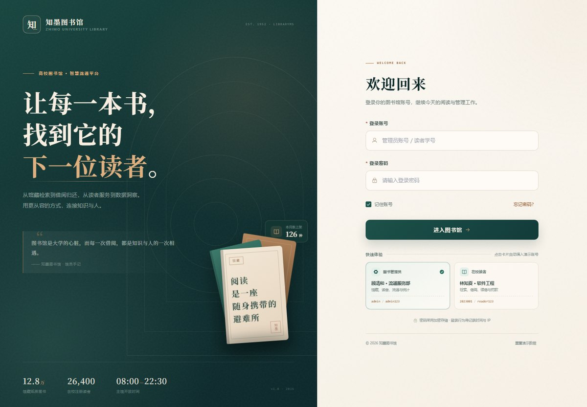
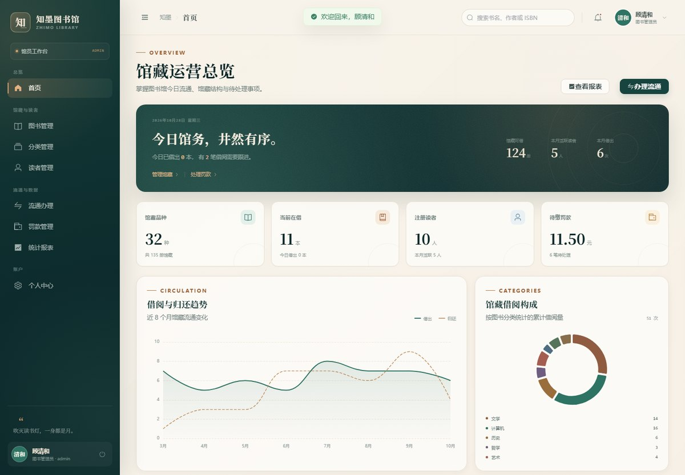
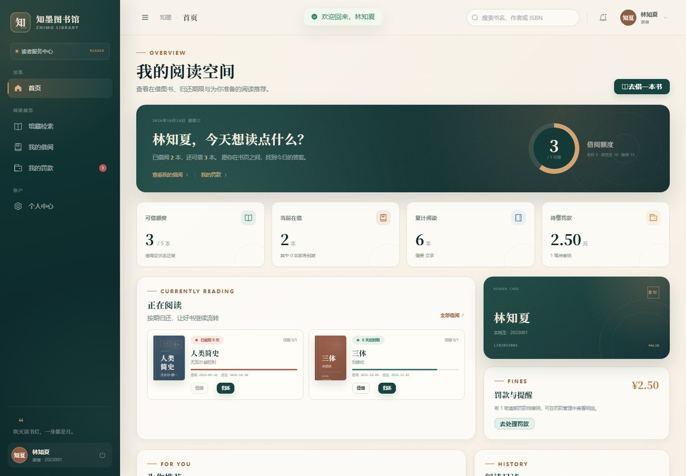

# 知墨图书馆 · 高校图书管理系统

> 让每一本书，找到它的下一位读者。

面向高校图书馆的全栈课程设计项目，覆盖 **读者管理、图书管理、借阅管理、查询统计、罚款管理** 五大模块。
同一套工程支持 **ADMIN / READER 双角色**：前端提供可直接操作的完整交互，后端提供真实的 MySQL 事务、JWT 认证与接口级鉴权。



| 管理员工作台 | 读者阅读空间 |
| --- | --- |
|  |  |

更多界面：[馆藏检索](docs/screenshots/catalog.jpg) · [流通办理](docs/screenshots/circulation.jpg) · [统计报表](docs/screenshots/analytics.jpg) · [我的借阅](docs/screenshots/my-borrows.jpg) · [移动端登录](docs/screenshots/mobile-login.jpg)

## 项目亮点

- **真实可运行的服务端业务**：借书/还书/续借在 Service 事务中执行，库存、借阅记录与罚款保持一致；JWT 无状态认证 + 方法级鉴权。
- **可直接演示的前端**：默认启用同契约 Mock API，`npm install && npm run dev` 即可体验全部页面与交互，不依赖数据库。
- **前后端契约解耦**：页面只通过 `src/api/*.js` 访问 `/api`；Mock 与 Spring Boot 的路径、字段、状态码一致，设 `VITE_USE_MOCK=false` 即可无缝切换。
- **业务规则落到代码**：借阅证状态、借阅上限、重复借阅、续借次数、逾期罚款、罚款幂等、登录失败锁定、角色数据隔离。
- **为五人分工设计**：按业务域纵向拆分，模块内高内聚，模块间通过 HTTP 契约和共享常量耦合；分支、评审与验收规范见 [`docs/团队分工与协作.md`](docs/团队分工与协作.md)。
- **认真做过的界面**：纸张与墨绿视觉体系、程序化图书封面、响应式布局、角色动态菜单、ECharts 图表、抽屉与操作反馈。

## 技术栈

| 层 | 技术 |
| --- | --- |
| 前端 | Vue 3（`<script setup>`）+ Vite 6 + Element Plus + Pinia + Vue Router（history）+ Axios + ECharts + Day.js |
| 后端 | Java 17 + Spring Boot 3.5 + Spring Security + JWT（jjwt）+ MyBatis-Plus 3.5 + Bean Validation |
| 数据库 | MySQL 8.0+（InnoDB / utf8mb4），BCrypt 密码存储 |
| 构建 | npm / Maven（附带 Maven Wrapper） |
| 部署 | Nginx 静态托管 + `/api/` 反向代理 + history fallback |

> 登录失败锁定使用数据库字段（`failed_attempts`、`locked_until`）实现，不引入 Redis；
> 理由见 [`docs/核心业务说明.md`](docs/核心业务说明.md#42-为什么用数据库实现锁定不用-redis)。

## 参与开发

仓库：`git@github.com:QmwmQ-var/LibraryMS.git`（HTTPS：`https://github.com/QmwmQ-var/LibraryMS.git`）

```bash
git clone git@github.com:QmwmQ-var/LibraryMS.git
cd LibraryMS
git switch feature/catalog      # 切到自己负责的分支，见下表
cd frontend && npm install && npm run dev
```

| 分支 | 负责人 | 范围 |
| --- | --- | --- |
| `feature/platform-auth` | A | 工程底座、认证、权限、布局、设计系统 |
| `feature/catalog` | B | 图书、分类、检索 |
| `feature/readers` | C | 读者档案、借阅证、个人中心 |
| `feature/circulation` | D | 借阅、归还、续借、预约、罚款 |
| `feature/analytics` | E | 仪表盘、统计、SQL、种子数据 |
| `develop` | 轮值集成人 | 每日集成，周五验后合入 `main` |

- 上手最短路径：[`CONTRIBUTING.md`](CONTRIBUTING.md)
- 网页端设置与推送、成员首次上手、故障排查：[`docs/远程协作操作手册.md`](docs/远程协作操作手册.md)
- 模块边界、分支规范、评审要求：[`docs/团队分工与协作.md`](docs/团队分工与协作.md)

仓库已配置 `.github/CODEOWNERS`（按模块自动指派评审人）、PR/Issue 模板与 CI（后端 `mvn test` + 前端 `npm run build`）；`main`、`develop` 为保护分支，改动一律走 PR。

## 功能概览

| 模块 | 读者 | 图书管理员 |
| --- | --- | --- |
| 认证 | 登录、退出、修改密码 | 同左 |
| 馆藏 | 多条件检索、图书详情、借阅 | 图书/分类增删改查、库存维护 |
| 借阅 | 我的借阅、续借、归还 | 流通台借还、借阅台账、为任意读者办理 |
| 罚款 | 我的罚款、在线缴纳、规则说明 | 罚款台账、确认收款、CSV 导出 |
| 读者 | 个人信息、借阅证 | 读者档案、借阅证挂失/注销 |
| 数据 | 个人阅读概览 | 仪表盘、借阅趋势、分类构成、排行榜、逾期分析 |

**核心业务规则**

- 读者类型：本科生 5 本/30 天，研究生 10 本/60 天，教师 15 本/90 天。
- 借阅证状态：正常 / 挂失 / 注销；非正常状态禁止借书。
- 借书校验：读者状态、库存、上限、是否重复借阅；同一事务内扣库存并写记录。
- 续借：每本最多 1 次；逾期不可续借；被预约不可续借。
- 还书：更新实际归还日期、恢复库存；逾期天数 × 每日费率（默认 ¥0.50）一次性生成罚款。
- 罚款：待缴 / 已缴；重复缴纳被幂等拦截，费率快照不随配置变化。
- 登录：连续 3 次失败锁定 15 分钟；记录登录时间与 IP。

## 目录结构

```text
LibraryMS/
├── frontend/                 # Vue 3 前端
│   ├── src/
│   │   ├── api/              # Axios 按模块封装，唯一出站层
│   │   ├── components/       # 通用组件（书籍封面、卡片、图表、页头）
│   │   ├── layouts/          # 双角色主布局、顶栏、侧边栏
│   │   ├── mock/             # 同契约 Mock API（按业务域拆分）
│   │   ├── router/           # 路由、角色 meta、动态菜单
│   │   ├── stores/           # Pinia：登录态、通知、布局
│   │   ├── views/            # login/book/category/reader/borrow/penalty/stats/profile
│   │   └── assets/styles/    # 设计令牌、全局样式、Element Plus 覆写
│   └── package.json
├── backend/                  # Spring Boot 后端（模块说明见 backend/README.md）
│   ├── src/main/java/com/university/library/
│   │   ├── common/           # 响应/异常/JWT/Security/配置/常量
│   │   ├── controller/       # 薄控制器
│   │   ├── service/          # 业务规则与事务
│   │   ├── mapper/           # MyBatis-Plus + 行锁/库存条件更新
│   │   ├── entity/dto/vo/    # 实体、入参、出参分离
│   │   └── ...
│   ├── src/test/             # 单元测试 + H2 接口集成测试
│   └── mvnw / mvnw.cmd
├── database/                 # schema.sql + data.sql（BCrypt 种子账号）
├── deploy/nginx.conf         # 生产部署参考
├── docs/                     # 分工、接口、数据库、核心业务、开发文档、演示手册
└── README.md
```

## 快速开始

### 环境要求

| 用途 | 要求 |
| --- | --- |
| 仅前端演示 | Node.js ≥ 20.19（建议 22 LTS）、npm |
| 全栈运行 | 上述 + Java 17+、Maven 3.9+（或使用 `mvnw`）、MySQL 8.0+ |

### 方式一：前端Mock演示（仅供演示，无需数据库）

```bash
cd frontend
npm install
npm run dev
```

打开终端提示的地址（默认 `http://127.0.0.1:5173`）。默认读取 `.env.development` 中的
`VITE_USE_MOCK=true`，所有 `/api` 请求由内置 Mock 接管，数据保存在浏览器 `localStorage`。
登录页点击「快速体验」卡自动填入账号。

| 角色 | 账号 | 密码 |
| --- | --- | --- |
| 图书管理员 | `admin` | `admin123` |
| 读者（本科生） | `2023001` | `reader123` |
| 读者（研究生） | `2022008` | `reader123` |
| 读者（教师） | `2021012` | `reader123` |

> 演示数据可随时从登录页底部「重置演示数据」恢复。

### 方式二：连接真实后端(开发阶段使用)

**1. 初始化 MySQL**

```bash
mysql -u root -p < database/schema.sql
mysql -u root -p < database/data.sql
```
然后在数据库界面勾选`libraryms`架构

**2. 启动后端**

默认连接 `localhost:3306/libraryms`，账号 `root`、空密码。推荐用环境变量覆盖，不要修改仓库默认配置  
可选以下命令方式，或在idea中设置环境变量并点击绿色箭头运行

```powershell
# PowerShell
$env:DB_PASSWORD="你的数据库密码"
$env:JWT_SECRET="请替换为至少32字节的随机字符串"
cd backend
.\mvnw.cmd spring-boot:run
```

```cmd
:: Windows CMD
set DB_PASSWORD=你的数据库密码
set JWT_SECRET=请替换为至少32字节的随机字符串
cd backend
mvnw.cmd spring-boot:run
```

```bash
# macOS / Linux
export DB_PASSWORD='你的数据库密码'
export JWT_SECRET='请替换为至少32字节的随机字符串'
cd backend
./mvnw spring-boot:run
```

服务地址：`http://localhost:8080`。如果本机已安装 Maven，也可以使用 `mvn spring-boot:run`。

**3. 启动前端并关闭 Mock**

```bash
cd frontend
npm install
npm run dev -- --mode backend
```

也可以复制 `.env.example` 为 `.env.local` 后执行 `npm run dev`；两种方式都会关闭 Mock。
Vite 的 `server.proxy` 会把 `/api` 转发到 `http://localhost:8080`，前端代码无需任何修改。

**4. 关键配置**（`backend/src/main/resources/application.yml`）

| 配置 | 默认 | 说明 |
| --- | --- | --- |
| `DB_HOST/DB_PORT/DB_NAME/DB_USERNAME/DB_PASSWORD` | localhost/3306/libraryms/root/空 | 环境变量覆盖 |
| `JWT_SECRET` | 开发默认值 | 生产必须替换，至少 32 字节 |
| `JWT_EXPIRE_MINUTES` | 720 | Token 有效期 |
| `app.penalty.rate-per-day` | 0.50 | 每日罚款费率 |
| `app.login.max-fail-attempts` / `lock-minutes` | 3 / 15 | 登录锁定 |
| `app.cors.allowed-origins` | 本地 5173、4173 | 生产域名按需配置，禁止 `*` |

## 构建与验证

```bash
# 前端演示构建（Mock 开启）
cd frontend && npm run build

# 前端生产构建（连接真实后端，Mock 关闭）
cd frontend && npm run build:backend

# 后端测试与打包
cd backend && ./mvnw test
./mvnw -DskipTests package
```

当前仓库的验证结果：

- 前端 `vite build` 通过，浏览器控制台无运行时错误；
- **后端 25 个测试全部通过**（认证 7、借阅 10、罚款 5、H2 全链路接口 2、容器冒烟 1）；
- **48 项真实 MySQL API 检查通过**（登录、权限、CRUD、借还、续借、幂等、罚款、锁定、通知路径）；
- **21 项前端 + 真实后端联调检查通过**（Vite 代理、双角色页面、图表、借还交互、Mock 关闭校验）；
- 无数据库 Mock 模式下 **17 项主链路交互检查通过**；
- 1440px 桌面与 390px 移动端均完成截图检查。

> 本机联调使用 MySQL 9.4.0（兼容 MySQL 8.0+ 语法）与临时实例；自动化验收脚本仅用于本地验证，不纳入交付依赖。
> 运行命令与环境说明见 [`docs/项目开发文档.md`](docs/项目开发文档.md#7-测试与验收)。

## 接口与文档

- [接口清单](docs/接口清单.md)：完整路径、权限、参数、返回结构、错误码。
- [数据库设计](docs/数据库设计.md)：ER、表字典、索引、状态机、初始化说明。
- [核心业务说明](docs/核心业务说明.md)：借阅事务、罚款、续借、JWT、登录锁定、Mock 契约。
- [五人分工与协作](docs/团队分工与协作.md)：模块边界、分支策略、提交规范、**角色与操作权限（谁能做什么）**。
- [远程协作操作手册](docs/远程协作操作手册.md)：GitHub 网页设置（仅仓库管理员）、推送、成员上手、故障排查。
- [参与开发指南](CONTRIBUTING.md)：环境要求、分支归属、提交规范、PR 五步流程。
- [项目开发文档](docs/项目开发文档.md)：架构、开发过程、测试、部署与已知边界。
- [演示手册](docs/演示手册.md)：8 分钟现场演示路径与常见答辩问题。
- [验收记录](docs/验收记录.md)：构建、25 个后端测试、48 项 MySQL API 与 21 项全栈联调结果。
- [示例 Nginx 配置](deploy/nginx.conf)。
- [后端模块说明](backend/README.md)。

## 五人分工摘要

| 成员 | 业务域 |
| --- | --- |
| A | 平台基建、认证、权限、布局、设计系统、部署 |
| B | 图书、分类、检索 |
| C | 读者、借阅证、个人中心 |
| D | 借阅、归还、续借、罚款、流通台 |
| E | 仪表盘、统计报表、SQL、测试、文档 |

每个人对自己模块的前后端负责，公共层由 A 维护。详细依赖顺序、分支和验收标准见
[`docs/团队分工与协作.md`](docs/团队分工与协作.md)。

## Nginx 部署

```bash
cd frontend
npm run build:backend          # 使用 .env.backend，关闭 Mock，走真实 /api
# 将 frontend/dist 上传到 /usr/share/nginx/html/libraryms
# 参考 deploy/nginx.conf 配置 /api/ 反向代理与 try_files fallback
nginx -t && nginx -s reload
```

> `npm run build` 生成的是前端演示包（Mock 开启，适合无后端的静态展示）；
> 生产部署请务必使用 `npm run build:backend`。

Nginx 仅作为部署扩展性预留，本地开发不需要启动。前端使用 **history 模式**，示例配置已包含
`try_files $uri $uri/ /index.html;`。

## 后续迭代与预留接口

- 图书预约：`book.reservation_count` 与“不可续借”规则已预留，预约队列/通知待开发；
- 封面/头像上传、站内信、邮件/短信通道、在线支付回调；
- 馆员权限细分、操作审计、批量导入导出（MARC/Excel）；
- 更大数据量下的 SQL 聚合与缓存。

## License

本项目为课程设计代码，可自由用于学习与教学演示。
