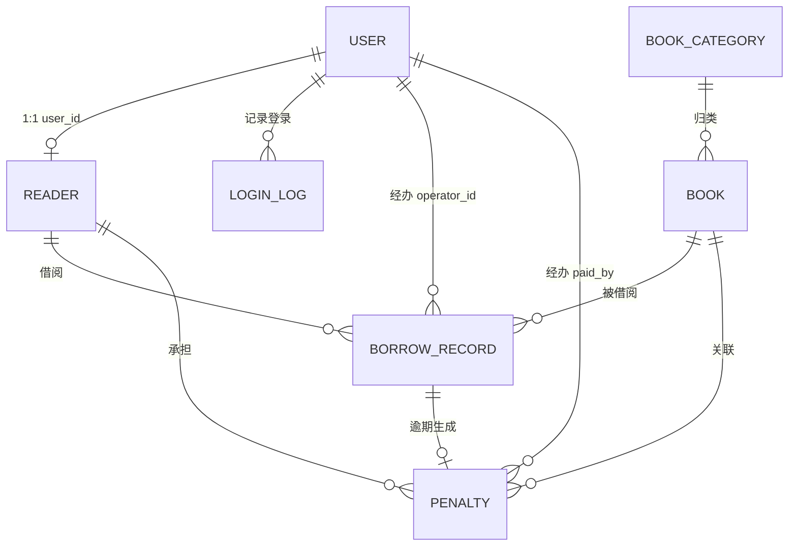

# 数据库设计说明

> 完整可执行脚本：[database/schema.sql](../database/schema.sql)、初始化数据：[database/data.sql](../database/data.sql)
> 数据库：MySQL 8.0+（InnoDB / utf8mb4 / utf8mb4_0900_ai_ci）；金额使用 `DECIMAL(10,2)`，日期使用 `DATE`，审计时间使用 `DATETIME`。

## 1. ER 关系



- `user` 与 `reader` 一对一：管理员只有 `user`，读者两种记录都有。
- 借阅记录与罚款一对一：`penalty.record_id` 唯一，保证重复还书不会重复罚款。
- 借阅记录冗余 `reader_name / reader_no / book_title / book_isbn` 快照，图书/读者逻辑删除后历史仍可读。
- `book_category`、`book`、`reader` 使用 `deleted` 逻辑删除，保留外键与历史数据完整性。

## 2. 表清单

| 表名 | 作用 | 关键约束/索引 |
| --- | --- | --- |
| `user` | 管理员与读者统一登录账号 | `uk_user_username`、`idx_user_role`、`idx_user_status` |
| `reader` | 读者档案、类型、借阅证状态 | `uk_reader_user_id`、`uk_reader_student_no`、`uk_reader_card_no`、`idx_reader_type`、`idx_reader_card_status` |
| `book_category` | 图书分类 | `uk_category_name`、`uk_category_code` |
| `book` | 馆藏信息与库存 | `uk_book_isbn`、`idx_book_category`、`idx_book_title`、`idx_book_author`、`idx_book_available` |
| `borrow_record` | 借阅、应还、归还、状态、续借 | `idx_borrow_reader`、`idx_borrow_book`、`idx_borrow_status`、`idx_borrow_due_date`、组合索引 |
| `penalty` | 逾期罚款与缴纳 | `uk_penalty_record`、`idx_penalty_reader`、`idx_penalty_status`、`idx_penalty_created_at` |
| `login_log` | 登录时间、IP、成功/失败 | `idx_login_log_username`、`idx_login_log_created_at` |
| `announcement` | 仪表盘公告（扩展表） | `idx_announcement_created_at` |

## 3. 核心字段说明

### user

| 字段 | 类型 | 说明 |
| --- | --- | --- |
| `id` | BIGINT PK | 用户 ID，同时写入 JWT `sub` |
| `username` | VARCHAR(50) UNIQUE | 管理员账号 / 读者学号 |
| `password` | VARCHAR(100) | BCrypt 哈希，绝不返回前端 |
| `role` | VARCHAR(20) | `ADMIN` / `READER` |
| `status` | VARCHAR(20) | `ACTIVE` / `DISABLED` |
| `failed_attempts` | INT | 连续登录失败次数 |
| `locked_until` | DATETIME | 锁定截止时间；超过 3 次失败锁定 15 分钟 |

> 登录失败计数直接落库的原因：项目禁止引入 Redis，单实例课程设计场景下数据库足够；
> 集群部署时可迁移到 Redis 并以 `username` 为键。锁定状态是“共享状态”，放在 Cookie 或前端都不可靠。

### reader

| 字段 | 说明 |
| --- | --- |
| `type` | `UNDERGRADUATE`（5 本/30 天）、`GRADUATE`（10 本/60 天）、`TEACHER`（15 本/90 天） |
| `card_status` | `ACTIVE` 正常 / `LOST` 挂失 / `CANCELLED` 注销；非 ACTIVE 禁止借书 |
| `card_no / card_issued_at / card_expires_at` | 借阅证信息，个人中心展示 |
| `deleted` | 逻辑删除；删除前校验无未还图书 |

### book

| 字段 | 说明 |
| --- | --- |
| `total_copies / available_copies` | 馆藏总量 / 可借数量；借出 -1，归还 +1，全部在同一事务内 |
| `reservation_count` | 预约数预留字段；`> 0` 时禁止续借，预约模块后续扩展 |
| `rating` | 展示评分（非业务规则） |
| `deleted` | 逻辑删除；有未还副本时业务层禁止删除 |

### borrow_record

| 字段 | 说明 |
| --- | --- |
| `borrow_date / due_date / return_date` | 借出、应还、实际归还日期 |
| `status` | `BORROWED` / `RETURNED` / `OVERDUE`，显式维护，不只靠日期推算 |
| `renew_count` | 续借次数，最多 1 次 |
| `operator_id / returned_by` | 经办馆员，便于审计 |
| 快照字段 | 读者姓名/学号、书名/ISBN，逻辑删除后仍可展示 |

### penalty

| 字段 | 说明 |
| --- | --- |
| `overdue_days / amount` | 逾期天数、罚款金额（生成时固化） |
| `rule_rate` | 生成时的每日费率快照，后续调整费率不会回溯改历史 |
| `status` | `UNPAID` / `PAID` |
| `paid_at / paid_by / payment_channel` | 缴纳时间、经办人、`CASH` 或 `ONLINE` |

## 4. 关键索引与查询

| 查询场景 | 使用索引 |
| --- | --- |
| 按学号/姓名/院系检索读者 | `uk_reader_student_no`，姓名模糊查询可后续加前缀索引 |
| 按 ISBN 精确定位图书 | `uk_book_isbn` |
| 按分类、书名、作者筛选 | `idx_book_category`、`idx_book_title`、`idx_book_author` |
| 读者当前在借 | `idx_borrow_reader_status` |
| 图书在借副本 | `idx_borrow_book_status` |
| 逾期扫描/到期提醒 | `idx_borrow_status` + `idx_borrow_due_date` |
| 某读者是否重复罚款 | `uk_penalty_record` |
| 待缴罚款 | `idx_penalty_status` |
| 登录审计 | `idx_login_log_username` + `idx_login_log_created_at` |

## 5. 状态机

```text
借阅证：ACTIVE ──挂失──> LOST ──补办──> ACTIVE
             └────注销────> CANCELLED（不可借书）

借阅记录：
BORROWED ──到期未还──> OVERDUE ──归还──> RETURNED
BORROWED ──按时归还──────────────> RETURNED
BORROWED ──续借（<=1 次）──> BORROWED（due_date 延长）
OVERDUE 不可续借

罚款：UNPAID ──确认/在线缴纳──> PAID（不可重复支付）
```

## 6. 数据一致性约定

1. 借书/还书/续借通过 `@Transactional` 包裹，库存与借阅记录同时成功或同时回滚。
2. 借书前校验读者借阅证、借阅上限、库存、重复借阅；库存更新使用条件更新，防止并发超借。
3. 还书通过记录状态校验 + 记录行锁（或条件更新）保证幂等；罚款表 `record_id` 唯一作为最终兜底。
4. 罚款金额生成时固化，`rule_rate` 留下费率快照，后续配置变更不影响历史。
5. 金额统一用 `BigDecimal`，避免浮点误差。

## 7. 初始化方式

```bash
mysql -u root -p < database/schema.sql
mysql -u root -p < database/data.sql
```

种子数据包含 1 个管理员、10 位读者、8 个分类、32 种图书、近 8 个月借阅记录、当前在借与逾期罚款。
`data.sql` 使用相对当前日期的时间，任何时间导入都有可展示的图表与逾期数据。

| 角色 | 账号 | 密码 |
| --- | --- | --- |
| 管理员 | `admin` | `admin123` |
| 读者（本科生） | `2023001` | `reader123` |
| 读者（研究生） | `2022008` | `reader123` |
| 读者（教师） | `2021012` | `reader123` |

其余 `data.sql` 中的读者账号密码同为 `reader123`，密码均已 BCrypt 加密。
