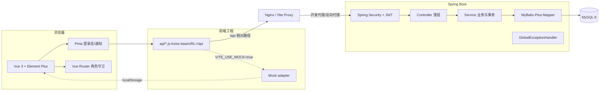

# 项目开发文档

## 1. 项目概述

“知墨图书馆”是面向高校图书馆的 B/S 图书管理系统课程设计。项目覆盖 **读者、图书、借阅、查询统计、罚款** 五大业务域，
支持 **读者（READER）** 与 **图书管理员（ADMIN）** 两类角色。系统不仅提供演示界面，也实现了真实的
Spring Boot 服务端事务、MySQL 持久化、JWT 认证与接口级权限。

### 1.1 建设目标

| 目标 | 落地方式 |
| --- | --- |
| 提高馆藏管理效率 | 图书/分类/读者 CRUD、组合检索、库存与借阅证状态维护 |
| 规范借阅流程 | 借书/还书/续借状态机、事务、上限校验、罚款自动生成 |
| 方便信息查询 | 馆藏多条件搜索、借阅台账、按读者/图书/日期筛选 |
| 辅助馆藏决策 | 借阅趋势、分类构成、热门排行、逾期分析、CSV 导出 |
| 便于五人协作 | 业务域纵向拆分、HTTP 契约 + Mock、公共层单一负责人 |

### 1.2 范围说明

**首期已实现**：主流程闭环（登录 → 检索 → 借阅 → 续借/归还 → 罚款 → 统计），预约排队与到书留书，
角色动态菜单与接口鉴权，图书/分类/读者管理、流通台、统计报表、个人中心，前端响应式与完整交互反馈。

**预留**：封面/头像上传、邮件短信通知、真实在线支付、馆员权限细分、批量导入、操作审计导出。
这些能力已在数据字段/规则/UI 上预留边界，详见 [`核心业务说明.md`](核心业务说明.md#9-已知边界与后续扩展)。

### 1.3 需求追踪

| 需求 | 实现位置 |
| --- | --- |
| 双角色权限、动态菜单 | `router/menu.js`、`router/index.js`、`SecurityConfig`、`@PreAuthorize` |
| 读者增删改查、类型/借阅证状态 | `ReaderService`、`views/reader/ReaderListView.vue` |
| 图书/分类增删改查、组合检索 | `BookService`、`CategoryService`、`views/book/*`、`views/category/*` |
| 借书/还书/续借与事务 | `BorrowService`、`views/borrow/*` |
| 借阅记录查询（读者/图书/日期） | `/api/borrow-records`、流通台账 |
| 罚款生成/查询/缴纳 | `BorrowService.returnBook`、`PenaltyService`、`views/penalty/*` |
| 借阅排行、逾期统计 | `StatsService`、`views/stats/StatsView.vue` |
| 登录、JWT、失败锁定、日志 | `AuthService`、`JwtAuthenticationFilter`、`login_log` |
| 建表 SQL 与测试数据 | `database/schema.sql`、`database/data.sql` |
| 接口清单/开发文档/Nginx | `docs/*`、`deploy/nginx.conf` |

## 2. 总体架构



### 2.1 前端职责

- **页面**只关心交互与展示，不直接访问 `localStorage` 业务数据、不硬编码后端地址；
- 所有请求经 `src/api`，统一附加 JWT、统一处理业务码与 401；
- Pinia 管理登录态和通知；Vue Router 用 `meta.roles` 做体验层拦截；
- Mock 层按业务域拆分，与后端同路径、同字段、同状态码，保证并行开发与零环境演示。

### 2.2 后端职责

- Controller：接收参数、`@Valid` 校验、调用 Service、包装统一响应，不写业务分支；
- Service：全部业务规则与 `@Transactional` 事务边界；
- Mapper：MyBatis-Plus + 少量自定义 SQL（行锁、库存条件更新）；
- DTO/VO 与 Entity 分离，禁止把密码或 Entity 直接返回；
- `common` 提供响应、异常、JWT、安全配置、常量与通用工具。

## 3. 技术选型与设计决策

| 决策 | 选择 | 原因 |
| --- | --- | --- |
| 架构 | 模块化单体 | 课程设计规模下部署简单，业务域清晰，避免微服务复杂度 |
| 前端状态 | Pinia | 官方推荐、类型/组合式友好；只放跨页面共享状态，页面数据就近管理 |
| 图表 | ECharts | 趋势、分类、逾期三种图形可复用；封装 `BaseChart` 统一尺寸与销毁 |
| 视觉 | 自定义 CSS 设计令牌 | 避免直接套用后台模板，形成“纸张 + 墨绿 + 铜色”的图书馆气质 |
| Mock | 自定义 Axios adapter | 页面与 api 层零改动即可切换真实后端；比在组件里造假数据更可维护 |
| 登录锁定 | MySQL 字段 | 禁止 Redis；低频强一致，重启不丢失，多实例可共享 |
| 借阅并发 | 读者行锁 + 库存条件更新 | 防止同一读者并发超限和库存扣成负数 |
| 罚款 | `record_id` 唯一 + 行锁 + 速率快照 | 保证幂等且历史金额不随费率变化 |
| 删除 | 逻辑删除 + 快照字段 | 保留历史借阅/罚款可读，满足审计与统计 |

## 4. 前端实现

### 4.1 路由与角色

| 路由 | 名称 | 角色 | 说明 |
| --- | --- | --- | --- |
| `/login` | login | 公开 | 登录，失败锁定提示 |
| `/dashboard` | dashboard | 全部 | 角色化首页 |
| `/books` | books | READER | 馆藏检索、借阅 |
| `/books-manage` | books-manage | ADMIN | 图书管理（共用页面，管理模式） |
| `/categories` | categories | ADMIN | 分类管理 |
| `/readers` | readers | ADMIN | 读者管理 |
| `/circulation` | circulation | ADMIN | 借还服务台 + 台账 |
| `/my-borrows` | my-borrows | READER | 我的借阅 |
| `/penalties` | penalties | READER | 我的罚款 |
| `/penalties-manage` | penalties-manage | ADMIN | 罚款管理 |
| `/stats` | stats | ADMIN | 统计报表 |
| `/profile` | profile | 全部 | 个人中心 |
| `/403`、`/:pathMatch(.*)*` | forbidden / not-found | — | 错误页 |

守卫流程：无 Token → 登录；有 Token 无用户 → `/auth/me`；角色不符 → 403；登录后访问登录页 → 首页。

### 4.2 状态与请求

- `useAuthStore`：token、user、reader 视图、登录/恢复/退出/改密；token 存 localStorage；
- `useAppStore`：侧栏折叠、移动端抽屉、通知列表、已读状态；
- `api/http.js`：唯一 Axios 实例；baseURL `/api`；请求拦截注入 Bearer；响应拦截统一解包 `data`；
  `code != 200` 转为 Error；401 清理登录态并跳转；
- 业务页面自行维护加载态、分页、筛选和错误提示，避免“万能 store”。

### 4.3 设计系统

- 设计令牌（`tokens.css`）：墨绿 `#123b38`、纸张 `#f8f3ea`、铜色 `#b5794b`；
- 衬线标题 + 无衬线正文，呈现大学图书馆的克制与温度；
- Element Plus 进行圆角、边框、阴影、表单、表格、弹窗统一覆写；
- 书籍封面由 CSS 程序化生成，按图书 ID 选择配色，不依赖外部图片；
- 动效控制：页面入场、卡片悬停、抽屉/弹窗，均避免干扰操作；
- 断点：≤1180px 缩小间距、≤960px 侧栏抽屉化、≤860/620/520px 逐级重排。

### 4.4 交互细节

- 借阅/归还/续借/缴纳全部有确认、loading、成功弹窗/结果数据；
- 表单校验覆盖 ISBN、学号、手机号、邮箱、必填、数量；
- 新增图书后自动按书名定位，避免新书落在末页找不到；
- 统计页周期切换、CSV 导出；罚款页支持状态筛选和规则说明；
- 空状态、错误状态、加载骨架、角色无权限页均有专门设计。

## 5. 后端实现

### 5.1 分层

```
controller → service → mapper → MySQL
      ↘ dto / vo ↗
common: Result / BusinessException / GlobalExceptionHandler / JWT / Security
```

- 业务异常 `BusinessException(code,message)` 由 `GlobalExceptionHandler` 捕获，HTTP 统一 200，
  由响应体 `code` 表示结果（与前端 Mock 一致）；
- 参数校验异常转为 400，并保留可读字段错误；
- `PageResult` 统一 `records/total/page/size`；部分接口附加 `summary`。

### 5.2 安全

- `SecurityConfig` 无状态、关闭表单登录、放行登录接口，其余认证；
- JWT HS256，`sub=userId`，附带 `role/username`；过滤器每次回查用户状态；
- `UserPrincipal` 暴露 `userId / role / readerId`，Service 做资源归属二次校验；
- CORS 白名单配置化，生产按域名替换；
- 登录失败计数/锁定字段持久化，登录日志记录 IP 与结果。

### 5.3 事务与一致性

- 借书、还书、续借、罚款支付均为 `@Transactional`；
- 借书使用读者行锁 + 条件扣库存 + 上限校验；
- 还书使用记录行锁 + 状态判定 + 库存回补 + 唯一罚款；
- 罚款金额 `BigDecimal`，生成时固化；
- 逻辑删除保留历史快照。

### 5.4 统计

- 8 个月借还趋势（按借出/归还日期）；
- 分类构成（按借阅记录所在图书分类）；
- 图书/读者排行（可限定时间范围）；
- 逾期趋势、逾期区间、待缴金额、当前逾期清单；
- 仪表盘按角色拼装概览、趋势、推荐、待办、最近动态与通知。

## 6. 开发过程

1. **需求梳理**：从报告与需求文档提取六类用况、五模块、角色与业务规则；页面草图与数据字典；
2. **契约先行**：定义统一响应、分页、状态枚举、接口路径和权限矩阵；
3. **前端优先**：先搭布局、设计系统、登录与路由；用 Mock 打通主流程，形成可评审界面；
4. **模块实现**：按图书/分类、读者、借阅/罚款、统计逐模块交付；公共层保持稳定；
5. **后端对齐**：Spring Boot 按同一契约实现，前端切换 `VITE_USE_MOCK=false` 即可联调；
6. **验证**：前端构建、无头浏览器主链路、后端单元测试 + H2 接口集成测试、代码 Review；
7. **交付**：SQL、Nginx、文档、演示手册与 Git 历史。

## 7. 测试与验收

### 7.1 自动验证

| 层级 | 项目 | 结果 |
| --- | --- | --- |
| 前端构建 | `npm run build` | 通过，无编译错误 |
| 前端运行时 | 控制台错误检查 | 通过，无错误 |
| 前端主链路 | 17 项浏览器自动化（登录、CRUD、借还、续借、罚款、锁定） | 17/17 通过 |
| 后端单元 | 认证 7、借阅 10、罚款 5，共 22 项 | 22/22 通过 |
| 后端接口 | H2 内存库全链路 2 项 + 容器冒烟 1 项 | 3/3 通过 |
| 真实 MySQL API | 登录、权限、CRUD、借还、续借、幂等、罚款、锁定、通知路径 | 48/48 通过 |
| 全栈联调 | Vite 代理 + 真实 Spring Boot + MySQL + 双角色页面 | 21/21 通过 |
| 视觉 | 1440px 桌面 + 390px 移动端 | 已截图检查 |

> 详细测试类：`AuthServiceTest`、`BorrowServiceTest`、`PenaltyServiceTest`、`ApiIntegrationTest`、
> `LibraryManagementApplicationTests`。Mockito 在 Windows 沙箱下使用 subclass mock maker，
> 见 `backend/src/test/resources/mockito-extensions/`。
>
> 真实 MySQL 验证使用本机临时实例（MySQL 9.4.0，`127.0.0.1:3307`）导入 `database/schema.sql`
> 与 `data.sql` 后，启动 `backend/target/libraryms-1.0.0.jar`，以 `VITE_USE_MOCK=false` 的 Vite
> 开发服务进行浏览器联调。验证脚本为本地辅助工具，不纳入交付依赖。

### 7.2 人工验收清单

- [x] 两类角色登录后菜单不同，越权路由 403；
- [x] 读者不能访问其他读者的借阅/罚款，接口仍会拒绝；
- [x] 挂失/注销借阅证无法借书；
- [x] 达上限、无库存、重复借阅均有明确提示；
- [x] 借书后库存 -1，还书后 +1；
- [x] 逾期归还生成正确金额，重复还书不重复生成；
- [x] 续借最多 1 次，逾期不可续；
- [x] 罚款缴纳后不可重复操作；
- [x] 连续 3 次密码错误锁定 15 分钟；
- [x] 新增/编辑/删除的边界提示；
- [x] 1440/390 宽度下主要页面可用。

## 8. 部署与运维

### 8.1 本地

- 前端 Mock：`cd frontend && npm install && npm run dev`
- 全栈：MySQL 导入 SQL → 后端 `./mvnw spring-boot:run` → 前端 `.env.local` 设 `VITE_USE_MOCK=false` → `npm run dev`

### 8.2 生产

- `npm run build:backend` 生成连接真实后端的 `dist/`（`.env.backend` 关闭 Mock）；
  `npm run build` 则生成 Mock 开启的静态演示包；
- Nginx 静态托管；
- `/api/` 反向代理到 Spring Boot 8080；
- `history` 模式回退 `index.html`；
- 配置 `DB_*`、`JWT_SECRET`、`app.cors.allowed-origins`；
- 建议 HTTPS、限流、日志采集、数据库备份与最小权限账号。

## 9. 已知限制

- 统计在内存聚合，数据量大时需下推 SQL 或引入缓存；
- 预约已实现排队、到书留书与领取，暂不支持指定馆藏地与到书短信/邮件提醒；
- 真实支付、消息通道、导入导出待扩展；
- 逻辑删除下唯一键不可复用（学号/ISBN/分类名）；
- JWT 退出仅前端删除，若要服务端强制失效可加 token 版本/黑名单；
- Mock 使用 localStorage 明文演示数据，仅用于演示，生产 Token/密码由后端管理。

## 10. 与课程报告的对应关系

| 报告章节 | 本文档/代码 |
| --- | --- |
| 一、需求分析（功能结构图、用况） | 第 1、4 节，`docs/演示手册.md` |
| 二、系统分析与设计（概念模型、顺序图、契约、类图、数据库） | 第 2、5 节，`docs/数据库设计.md`、`docs/接口清单.md` |
| 三、系统实现 | 代码与截图，`docs/screenshots/` |
| 四、课设总结 | 第 9 节与 `README.md` |
| 附录 类代码 | `backend/src/main/java/**` |

---

> **维护人**：E。
> **更新时机**：架构、依赖版本、构建与部署方式、测试数量变化时。
> **权限与文档分工**：[团队分工与协作.md 第 8 节](团队分工与协作.md#8-角色与操作权限)。
